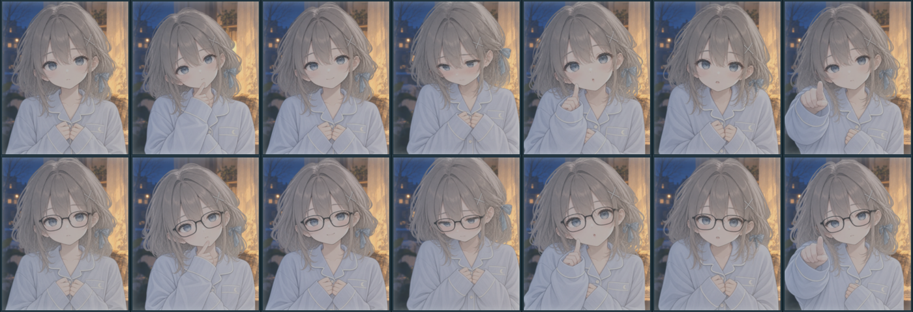
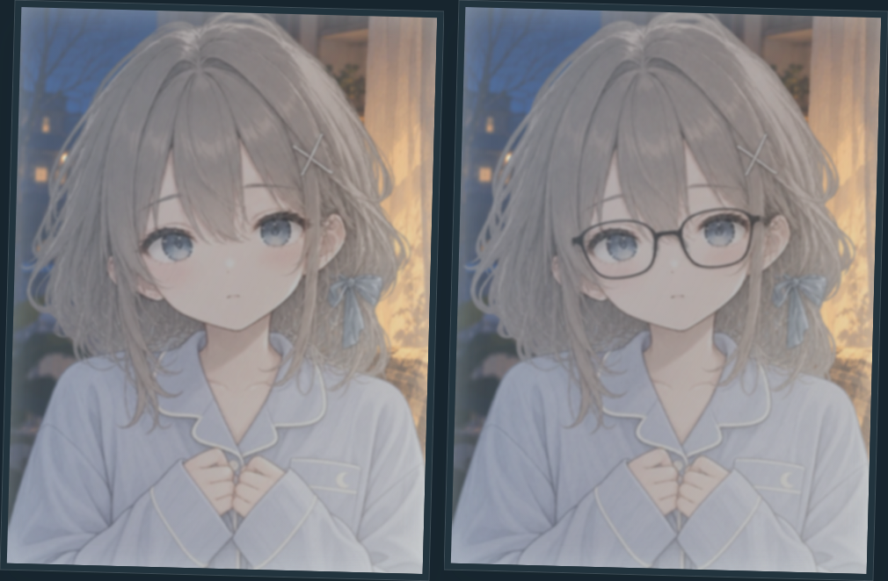

# NIGHT しずく・黒ぶち眼鏡の正式採用

## 候補と採用判断

少し大きめの、角を丸めた横長の黒ぶち。上辺とつるに存在感を持たせ、下辺は軽く、透明レンズには強い反射を入れない。パジャマ姿の「やさしさ・知性・夜のおうち感」を狙った1方向を通常ポーズで試し、同じ眼鏡を参照して全7ポーズへ展開した。

2026-11-14、ユーザーが7ポーズの見た目・パジャマとの相性・曇り越しの視認性を承認し、正式採用。照れポーズも現状維持とし、画像を再生成せず現在の7枚を使用する。タイトル・待機・プレビュー・本編のNIGHTに反映。公開ページ更新は未承認であり実施しない。

## 実画面比較

比較は左が眼鏡なし、右が眼鏡あり。7ポーズ一覧のみ上段がなし、下段があり。

並び順：通常、考え中、微笑み、照れ、吐息、興味、描画。

- [PC・日本語タイトル全体](../artifacts/qa/night-glasses/1280-ja-title-full.png)
- [390px・日本語タイトル全体](../artifacts/qa/night-glasses/390-ja-title-full.png)
- [390px・英語タイトル全体](../artifacts/qa/night-glasses/390-en-title-full.png)
- [390pxタイトル比較](../artifacts/qa/night-glasses/390-ja-title-comparison.png)
- [PC本編・合成ポインターで一筆](../artifacts/qa/night-glasses/1280-ja-game-comparison.png)
- [390px本編・合成ポインターで一筆](../artifacts/qa/night-glasses/390-en-game-comparison.png)
- [通常モーションの本編・描画ポーズ390px](../artifacts/qa/night-glasses/acting/390-girl_drawing.png)

画面キャプチャは実際のCharacterSceneとゲームUIをChromiumで描画したもの。比較用の眼鏡なし表示は画像srcだけを元素材へ戻した。UI・霧・部屋・レイアウトは同じ。ポーズ一覧はプレビュースクリーンショットの縮小配置であり、全ポーズが本編で同時表示される画面ではない。

## 変更範囲と素材

- `public/art/shizuku-night-glasses/`：384×512の透過WebPを7枚追加。
- `assets/source/shizuku-night-glasses/`：生成PNGと実際のプロンプトを保存。OpenAI built-in image_genで編集し、sharpは均等縮小・透明キャンバスへの収容・WebP変換のみ。
- `assets/shizuku-night-glasses-manifest.json`：画像ハッシュ・サイズ・既存の目位置アンカー。
- `src/data/shizukuPoses.ts`：NIGHT専用参照先のみ変更。既存の位置合わせ・描画指先・フォールバック設計は維持。
- DAY、元のNIGHT7枚、部屋の画像は変更しない。DAYは既存採用ハッシュのテスト、旧NIGHTは全7枚のmanifest SHA256照合で不変を確認。
- UIレイアウト・文言、曇り、描画、認識、判定、記念PNGの実装は変更していない。画像読込失敗時もNIGHTの眼鏡あり通常ポーズへ復帰する。

## 検証結果

- Vitest：66ファイル415テスト成功。関連する画像manifestとシーンの16テストも成功。
- TypeScript型検査・Vite本番ビルド成功。既存の500kB超チャンク警告は残る。
- オフライン整合性：14テスト成功。
- CIの語彙監査で画像参照ファイルの記録ハッシュ更新漏れを検出し、`audit-vocabulary.mjs` を再実行。`docs/vocabulary-coverage-v09.json` の `sourceSha256["src/data/shizukuPoses.ts"]` だけが更新され、語彙・集計結果は不変。文脈ポリシーレポートの `--check` も成功。
- [表示検証](../artifacts/qa/night-glasses/report.json)：1280/390px × 日本語/英語の4条件で、タイトル・NIGHTプレビュー7ポーズ・本編待機・合成ストロークを確認。エラー0。眼鏡なし/ありの切り替えで霧と描画のcanvas画素が一致。
- [本編ポーズ撮影](../artifacts/qa/night-glasses/acting/report.json)：通常モーションで1280/390pxの吐息・描画・待機を実フェーズで撮影。`scripts/qa-night-glasses-acting.mjs` で再現。
- [既存本編通し検証](../artifacts/qa/night-glasses/journey/after.json)：日英×DAY/NIGHTの4条件、各5往復・10枚・9リンク。CLEAR/UNDO/REDOの霧の一致、保存描画の再開、1200×3000記念PNGダウンロード成功。NIGHT日本語390pxは通常モーション、他は動き軽減。ページエラー・外部通信0。

再現：`node scripts/prepare-night-glasses.mjs`、開発サーバー起動後 `node scripts/qa-night-glasses.mjs`。QAのURLは `DRAWINDOW_QA_URL`、Playwrightの既存インストールは `DRAWINDOW_PLAYWRIGHT_MODULE` に `index.mjs` の絶対パスを渡せる。既存の `scripts/qa-night-presence.mjs` で本編通し検証も再現できる。今回の保存レポートは合成入力のDEMOであり、実モデル認識の精度評価ではない。

## 気になる点・未確認

- 生成編集なので、眼鏡以外の細部は元絵と完全な画素一致ではない。比較後、本人が現行7ポーズを正式採用した。
- 照れポーズの上ぶちとまつげの近さは本人が現状維持を承認。追加調整しない。
- 現行の演技選択ではNIGHTの吐息フェーズは通常ポーズを使う（`src/lib/character.ts` の `girl_breath`）。この仕様は維持した。吐息画像自体にも眼鏡を用意し、7ポーズすべてをプレビューで検証。本編の撮影レポートは実際に選ばれたポーズ名を記録している。
- 本人の見た目評価は承認済み。スマートフォン実機・Safari・音声の検証は別途未確認。390px Chromiumは実機試遊を代替しない。
- 依存復元時のnpm auditで既存開発依存 `wrangler → miniflare → undici` に計3件（high 1、moderate 2）のパッケージ警告。今回の画像変更で追加した依存はなく、lockfileは変更していない。依存更新は別件として残す。

## 既存ドキュメントとの食い違い

- READMEのv0.6節（旧101/122行付近）のDAY/NIGHT共通素材という記述と、現行コードのNIGHT専用パジャマは異なる。`assets/shizuku-adoption-v06.json` と `src/data/shizukuPoses.ts` のv0.6コメントも当時の採用履歴。現行のNIGHTコードと今回の依頼に従い、履歴は残したままREADME冒頭で現状を明示した。
- README「current product source」節のローカルcheckoutがmainを追うという記述と、実際のルートcheckout `codex/offline-first-v09` は異なる。実際のGit状態を優先。ルートの未コミット作業は触らず、既存night-presence worktreeを再利用し、確認済み最新main `0f38b049` から `codex/night-glasses-candidate` を作成した。README冒頭にブランチ確認の注記を追加。
