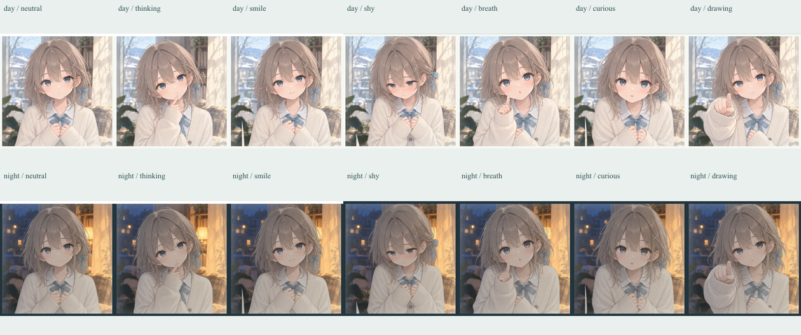
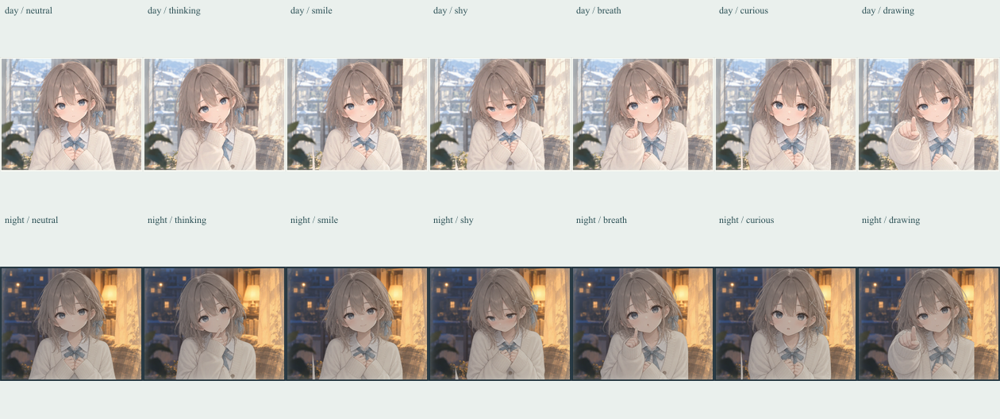
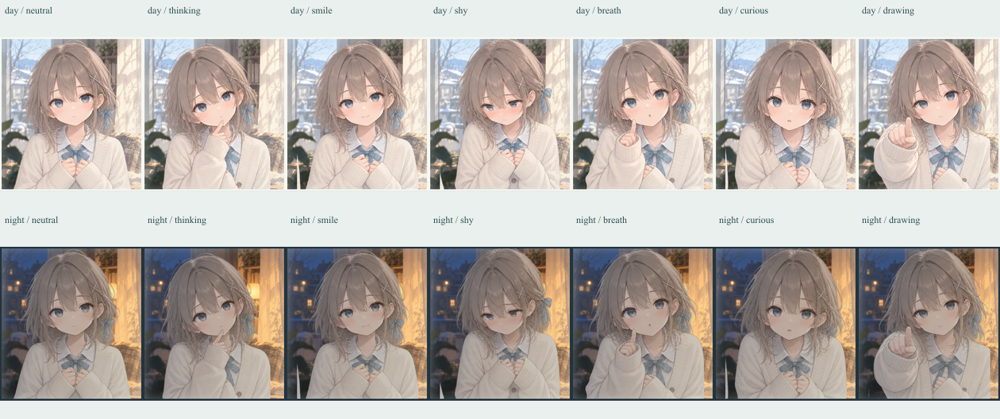

# しずく｜アート正式採用判断・演出改善 v0.6

2026-10-18 JST / PR #10 / `review/shizuku-expression-final-v05`。

## ユーザー最終判断

**7ポーズすべて、DAY/NIGHTともA案（現行本編素材）を採用する。B案は正式採用しない。**

| 正式ポーズ | 昼夜共通の本編素材 |
| --- | --- |
| NEUTRAL | `public/art/shizuku/neutral.webp` |
| THINKING | `public/art/shizuku/thinking.webp` |
| SMILE | `public/art/shizuku/smile.webp` |
| SHY | `public/art/shizuku/shy.webp` |
| BREATH | `public/art/shizuku/breath.webp` |
| CURIOUS | `public/art/shizuku/curious.webp` |
| DRAWING | `public/art/shizuku/drawing.webp` |

[採用マニフェスト・7枚のSHA-256](../assets/shizuku-adoption-v06.json)。元の `assets/shizuku-manifest.json` の記録とも一致し、今回人物画像のバイトは変更していない。人物の画像は昼夜共通で、背景と既存照明レイヤーだけが異なる。BLINKは従来のタイトル補助レイヤーであり、追加の感情ポーズではない。

v0.4高解像度4枚とv0.5改訂3枚は**不採用・制作資料として保持**。原画・正規化PNG・WebP・プロンプト・比較画像・検証JSON・既存マニフェストは削除／上書きしていない。過去の制作報告は履歴であり、そこに残る採用提案より本記録を優先する。明確な新しい問題が見つからない限り、再生成・高解像度化を実施しない。

`/?character-preview` は正式Aだけを表示する。資料は `/?character-preview&archive-candidates`（v0.4）と `/?character-preview&expression-final`（v0.5）から明示的に開ける。「B・不採用・保存資料」を表示し、採用待ちの表現を除いた。本編の画像選択にはBを渡さない。

## 既存7ポーズによる演技

| 状況 | 表情・仕草 |
| --- | --- |
| タイトル・待機 | NEUTRAL。従来の小さな呼吸と補助まばたき |
| 描き始める前 | THINKING。既存描画時間の最初の14%を利用し、追加の待ち時間なし。この間は描画開始の身体移動をしない |
| 自分が描く | DRAWING。描線の開始とともにDAYは2px、NIGHTは1pxの有限な動き |
| 描き終わり・手番渡し | 往復番号でNEUTRAL／SMILE。解釈結果や正誤に依存しない |
| プレイヤーが描く前 | NEUTRAL |
| 最初の一筆 | 点が1つでもある時点でCURIOUS。DAYは2px・倍率1.006、NIGHTは1px・倍率1.003、600msのごく小さい接近 |
| 続けて描く／UI操作 | CURIOUSを維持。各サンプル・追加ストローク・ヘルプ開閉で仕草を再生しない |
| CLEAR／最後のUNDO | 描線がなくなればNEUTRAL。1本でも残ればCURIOUS |
| 認識待ち | THINKING |
| 認識エラー | NEUTRAL。描線を保持。BACKで線のある描画へ戻るとCURIOUS |
| 意図を記入するレビュー | NEUTRAL |
| 最後のお別れ | DAYはSMILE、NIGHTはSHY。SHYを通常の各往復には使わず、静かな夜の結びに限定 |
| 息を吹く | 既存どおり昼はBREATH、夜はNEUTRALと静かな曇り直し |

選択関数には進行フェーズ・昼夜・往復番号・描画進捗・線の有無・Reduce Motionだけを渡す。スコア、正誤、推論語、意図、認識の成否による評価値は渡さない。認識エラーのフェーズは扱うが、失敗に落胆したり、不正解を示す表情にはしない。

## 動きと切替

- 既存の人物だけの上下動（DAY 5.8秒、NIGHT 7秒）を維持。背景や画面全体は動かさない。
- 新しい常時タイマーなし。有限のWeb Animations APIと既存CSSを使用。
- 非表示タブ／画面外では人物のCSS呼吸と有限な仕草をpauseし、戻ったときに同じ時点から続ける。完了した仕草は再生し直さない。アンマウント時にキャンセル・observer解除。
- Reduce Motionでは有限な仕草、呼吸、まばたき、クロスフェードを停止。静止した表情と描画入力は利用できる。
- 既存180msクロスフェードを維持。DOMの画像スタックを使い回し、共通の目のターゲット(50%,39.2%)にA各原画のアンカーを合わせる。原画の差し替え・拡大加工は行わない。
- 明示的な資料プレビュー以外からBへのリクエストが発生しないことをブラウザで監視。

## 検証

- `npm test`：**24ファイル・166テスト成功**。
- `npm run build`：TypeScript／Viteとも成功。
- A7枚の採用ハッシュを新規固定。既存の旧素材・v0.4・v0.5マニフェストに対する原画／出力／プロンプトの整合テストも成功。
- `scripts/qa-shizuku-acting-v06.mjs`：360×800、720×1280、1280×800 × DAY/NIGHTの**6条件**で、通常のDEMOを各5往復完走。合計30往復。各セッション10枚・9リンクを保持。各条件でAの全7ポーズ表示も確認（42表示）。
- 最初のpointerdown時点でCURIOUS、2本目では動き再生なし、UNDOで1本残る間はCURIOUS、最後を消すとNEUTRAL、CLEARで空になったときのDONE無効化、ヘルプ開閉で動き再生なしを確認。
- 7ポーズのDOMアンカーと表示先の目の基準点の差は0.1 CSS px未満。画像ロード失敗・console/page error・横溢れ・B案リクエストなし。
- 非表示の模擬 `visibilitychange` を実ブラウザのAnimationに適用し、CSS／有限な動きのpause、復帰時の時刻継続、完了後の再生なしを確認。画面外停止とobserver解除は自動テストでも確認。
- Reduce Motionの360px実ブラウザ検証：人物配下の実行中アニメーション0、transition 0s、描線入力で静止CURIOUSへ移行。
- 認識待ち／エラーはローカル専用ビルドでHTTPを差し替えた**昼夜2ケース**。650msの待ち中にTHINKING、502エラーでNEUTRAL、描画CanvasのPNGがエラー前後で一致、BACK後はCURIOUS、再送成功で次往復へ。実API・プロバイダへの通信は0。これは実認識精度の検証ではない。
- 正式A7枚、B資料、背景、音楽、ゲームreducer・スコア・認識アダプタ・Canvasの描線保存コードは変更していない。既存のモード保存、レビュー入力・描線保持も既存テストと5往復で確認。新たな永続化機能は追加していない。

[ブラウザの全結果JSON](../artifacts/qa/shizuku-acting-v06/browser-checks.json)。ブラウザ画面サイズと合成入力による検証であり、実機端末での操作感、音楽の聴感、第三者による自然さの評価を代行するものではない。

## DAY/NIGHT比較とゲーム全体

[ゲーム画面スクリーンショット](../artifacts/qa/shizuku-acting-v06/)には、ためらい・描画移行中／移行後・最初の一筆・結果、および昼夜の認識待ち／エラーフィクスチャを保存する。表情単独の比較は `-pose-` の画像で、ゲーム内の撮影と区別した。

制作側の目視では目の基準が揃い、180msの切替は短い混合として読める。原画ごとの首・髪・手の輪郭差は維持する。全身の輪郭まで同一になるという主張ではない。採用済みAそのものの再制作は行っていない。

## 再現と変更範囲

通常ビルドを `npm run preview -- --port 5186 --strictPort` で表示。

QAは既存のPlaywrightモジュールを `DRAWINDOW_PLAYWRIGHT_MODULE`、実行ブラウザを `DRAWINDOW_BROWSER_EXECUTABLE`、URLを `DRAWINDOW_QA_URL` で指定できる。認識エラーのシナリオを実行する場合だけ、`VITE_ENABLE_LIVE_API=true` を設定したViteビルドを `artifacts/local/v06-fixture-build` に作り、5187でローカル表示し `DRAWINDOW_FIXTURE_QA_URL` に指定する。自動テストがAPIリクエストを完全に差し替える。通常のdistは標準の `npm run build` のまま。

- 演技：`src/lib/character.ts`、`src/components/CharacterScene.tsx`／CSS。
- 採用表示：`src/components/CharacterPreview.tsx`、データファイルの注記。
- 検証：`character.test.ts`、`CharacterScene.test.tsx`、`shizukuPoses.test.ts`、QAスクリプトと結果。
- 判断記録：本書、採用マニフェスト、README／ASSETS／過去報告の現行判断への案内。

**mainへのマージ、公開、デプロイ、itch ZIP変更は行わない。PRで報告し、ユーザー確認を待つ。**
