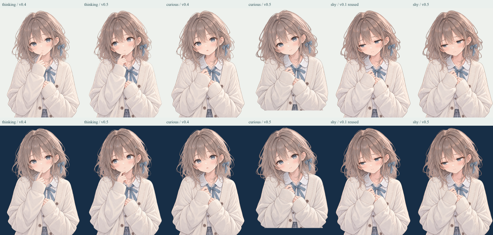
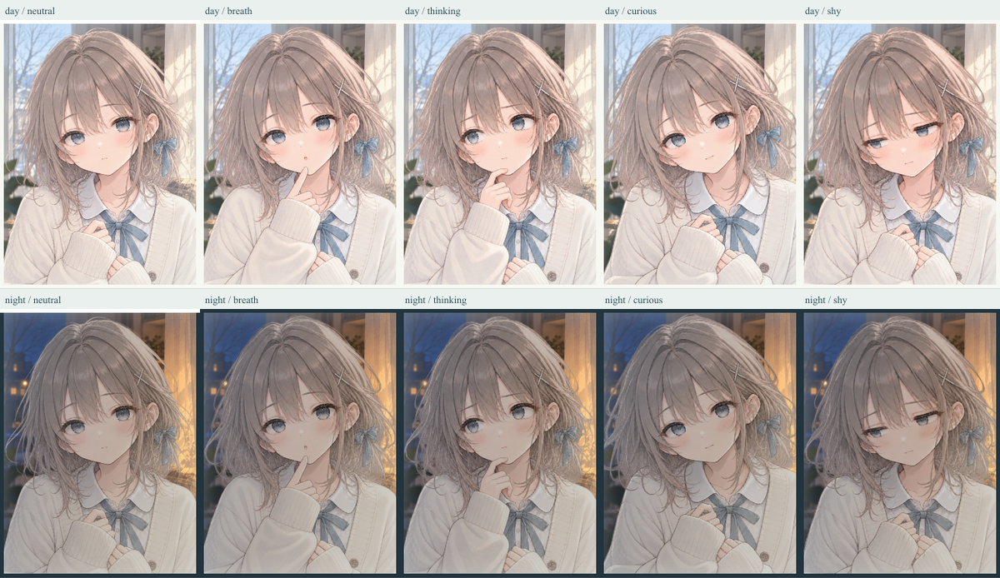
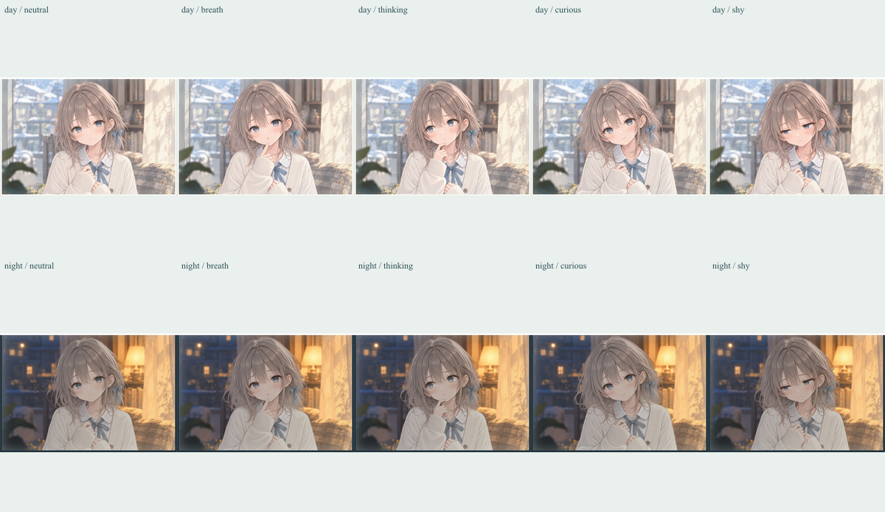
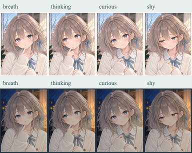
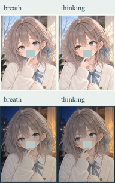

# しずく 表情素材・最終制作 v0.5

2026-10-18 JST。PR #10 / `review/shizuku-expression-final-v05`。**素材制作と採用判断の準備まで完了。ユーザー承認、本編の正式差し替え、mainへのマージ、公開は未実施。**

## 独立した人物スプライト

比較シートから切り抜いた画像ではなく、組み込みImageGenで参照編集した個別の人物画像。3枚とも背景・ガラス・曇りを含まない透過アルファ付きPNG原画。SHYは既存v0.1を再生成せず、原画SHA-256が一致するコピーを使用した。

| 表情 | 原画 1086×1448 PNG | ゲーム用 768×1024 WebP | 変更内容 |
| --- | --- | --- | --- |
| THINKING | [PNG](../assets/source/shizuku-expression-review/thinking.png) | [WebP](../public/art/shizuku-expression-review/thinking.webp) | 縦の指を顎に斜めに添える形へ。唇から離し、斜め上の視線、わずかに寄せた眉、閉じた口に編集 |
| CURIOUS | [PNG](../assets/source/shizuku-expression-review/curious.png) | [WebP](../public/art/shizuku-expression-review/curious.webp) | 首の傾き、静かな前のめり、観察する目、閉じた小さい口。手は胸元。右袖の輪郭を追加編集 |
| SHY v0.1 | [PNG](../assets/source/shizuku-expression-review/shy.png) | [WebP](../public/art/shizuku-expression-review/shy.webp) | 視線回避、ためらう口元、袖を握る仕草をそのまま保持 |

WebPサイズ：THINKING 206,776 bytes / CURIOUS 196,438 bytes / SHY 203,254 bytes。

## 原画保存・配置・透過

- 生成PNGは原バイトを保存。THINKING 1回、CURIOUSは表情編集＋袖の輪郭修正の2回。SHYは新規生成なし。
- [全プロンプト](shizuku-expression-final-v05-prompts.json)、[入力・原画・正規化PNG・WebPのSHA-256とアルファ計測](../assets/shizuku-expression-final-v05-manifest.json)。編集前のv0.4候補とSHYの元プロンプトは `assets/source/shizuku-expression-review/inputs/` に保存。
- [正規化PNG](../assets/source/shizuku-expression-review/normalized/)も保存。CURIOUSは顔が約8%大きく生成されたため、縦横共通0.93倍、原画座標で右74px・下8pxへ配置。他2枚は倍率1・移動なし。目の位置と人物スケールを揃えるための加工で、表情はImageGenで制作している。
- 手作業で測った眼窩中心の中点・眼間距離を基準にする。CURIOUSの中点は約(507,476)→(545.5,450.7)、眼間距離207→192.5。canonicalの約(545,451)・192に合わせた。手計測の誤差は約4原画px。瞳の向きまで強制的に揃えず、上目・伏し目は残す。
- 全3枚は共通anchor (0.502,0.312) / renderScale 1.28。昼夜で同じWebPを使い、既存ゲームの背景・照明・ガラスを別レイヤーで適用。
- WebP quality94 / alphaQuality100。透明画素は約33〜36%、近不透明(alpha>=240)画素は60%以上。半透明の髪・衣服の塗りを保持し、背景色の除去やアルファしきい値処理は行っていない。
- 3枚とも左右端のalpha>=16画素は0。原画は腰上の切り取りで、全身素材ではない。CURIOUSは顔サイズ合わせで下端に透明余白ができるが、ゲームの表示窓では腰の切断線は見えない。
- `assets/shizuku-manifest.json` / `assets/shizuku-v04-manifest.json` の記録済み全入力・出力のハッシュを照合し、一致を確認。既存原画・本編スプライト・既存マニフェストは変更していない。
- 参照は既存プロジェクト内のオリジナルキャラクター。新規第三者素材、権利・ライセンス変更なし。交差銀ピン、青い髪リボンと襟元リボン、髪型、衣装、細い鉛筆／水彩の描線を目視照合。生成編集のため細線まで同一画素であるとは主張しない。

## 採用判断用の表示

起動：`npm run build` → `npm run preview -- --port 5186 --strictPort`。

URL：`http://localhost:5186/?character-preview&expression-final`。

通常ゲームと共通の `CharacterScene` で表示する専用プレビュー。左／上はPRブランチの現行本編素材、右／下は候補。`expression-final`を付けたプレビューだけ3枚の最終候補を使用する。通常ゲームや通常のv0.4プレビューには採用しない。既存のv0.4 4枚もこのPRでは候補のまま。

720px幅で旧比較レイアウトが149px幅の細い窓になる問題を修正。1000px以下は比較を縦並びにし、指定2画面で最低300pxの窓幅を検査する。比較用シートも縦横比を保って縮小し、画像を引き伸ばさない。

### 元候補と改訂画像

SHY列は同じv0.1原画を再利用したことの比較。上段は明色、下段は暗色の単色合成で透過の縁も確認する。

### 昼夜のゲーム描画レイヤー

各表情の実サイズスクリーンショット、ガラスあり／なし、現行本編との比較は [QAフォルダ](../artifacts/qa/shizuku-final-v05/) に保存。

## 制作側の目視評価

| 観点 | 評価 |
| --- | --- |
| THINKING / BREATH | 旧案の縦の指に対し、顎に横向きに曲がる指と下がった手首で違いを補強。閉じた口と斜め上の視線も読める。96pxで口を覆っても指の角度差は残るが、髪・袖・腕の大枠は共通なので差は控えめ。第三者による識別率は未測定 |
| CURIOUS | 丸い開口をなくし、首と肩の傾き、近い対象を見守る目で「観察」を補強。元候補より驚きに見えにくい。前傾は静かな演技の範囲で、動的な大きい接近ではない |
| SHY v0.1 | 袖を寄せて握る手と外した視線、控えめな口元を維持。涙・苦痛・強い眉の落ち込みはない。NIGHTや96pxでは内省的／少し寂しげとも読める余地があり、自然さの最終判断はユーザーに残す。指示に従い再生成なし |
| 同一人物・余白 | 顔・髪飾り・リボン・衣装は同じしずくとして揃う。CURIOUSの顔拡大を正規化し、顔の切り替え位置を揃えた。袖・髪に単色の背景や四角い不透明領域なし |

制作側として3枚を採用判断に提示できる品質と評価する。これはユーザーの承認、第三者のブラインド評価、端末実機試験の代わりではない。

## 検証結果

- `node scripts/prepare-shizuku-final-v05.mjs`：原画解像度、真のアルファ、共通サイズ、左右端、旧2マニフェストの全ハッシュを検証。
- `npm test`：24ファイル、161テスト成功。最終候補の明示指定、入力／原画／正規化PNG／WebPハッシュ、既存素材の保持を含む。
- `npm run build`：TypeScript・Viteとも成功。
- `node scripts/qa-shizuku-final-v05.mjs`：Chromium系Edgeで360×800・720×1280 × DAY/NIGHT、4条件・20表情表示。画像欠落、横溢れ、console/page errorなし。ガラス切替、Reduce Motion、180msクロスフェード、DOM維持、候補のBLINK抑止を検証。通常DEMOが最終候補を一切リクエストしないことも確認。[JSON結果](../artifacts/qa/shizuku-final-v05/browser-checks.json)
- ワークツリーの開発サーバーでは親階層の依存フォント取得に403が出たため、QAはビルド済みdistのローカルプレビューで実施。フォント・画像が正常取得できる状態で再検証済み。
- Playwrightは環境変数 `DRAWINDOW_PLAYWRIGHT_MODULE` で既存環境のモジュールを指定可能。`DRAWINDOW_BROWSER_EXECUTABLE` でブラウザ、`DRAWINDOW_QA_URL` でURLを指定可能。

既存のPRに含まれる「最初の描線でCURIOUSになる」表情選択実験は維持し、今回は新しいゲームルールや認識判定を追加していない。ブラウザの模擬画面サイズ確認であり、物理端末の表示・第三者の感情識別は未検証。正式差し替え、mainマージ、itch ZIP変更、デプロイはしていない。
