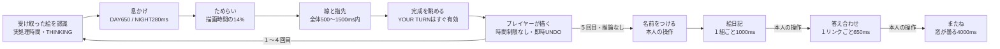

# 窓辺の時間：時間設計の監査と研究設計

## 起点と保護

PR #31 HEAD `590cd1bd73c39e88e8d7e8c66e3a3501886fac8b`、main `876bb7f8ee2d0513cbaa00d37d66029cd76ccc36`。起点のReview checks / offline local labは成功、研究元worktreeはclean。元のC:\Dev\Projects\drawindowにはWindows梱包関連の未コミット成果があり、触れていない。新しい `codex/v012-window-time` / 専用worktreeで作業する。

本編はA、Dの採用は保留。認識器・reducer・辞書・スコア・291絵・７表情・音源は変更しない。DEV限定のCanvas差し込みで時間だけを変える。通常５往復と比較再生は同じTempoPlan/TempoCanvasを使い、#31のWindowCanvas/StrokeTipOverlayによる線と指先の同期を維持する。

## 現行の時間の地図

| 要素 | 現行の根拠 | 忙しさの種類 |
| --- | --- | --- |
| 線の全再生 | playback.tsの500〜1500ms、14%のためらいを含む | **動作が速い**。複雑な絵も上限1.5秒 |
| ペンを離す | createTimedStrokesは最大35ms程度の間、採用絵は独自timestamp | 線間の間が短く、筆数が多いと追いづらい可能性 |
| 描画の終端 | characterDrawingProgressは終盤を少し加速 | 最後の線を静かに終えたい設計と逆方向 |
| 表情 | THINKING→息→描く前のTHINKING→DRAWING→SMILE/NEUTRAL、180ms crossfade | **動作・切替が多い**。短い描画の中に追加切替 |
| 身体 | phaseごとの有限gestureに5.8秒/7秒の常時呼吸が重なる | **動作が重なる**。指先へ視線を向けづらい可能性 |
| 昼夜 | 息650/280ms、描画clampは共通 | 夜は静かでも時間が短い。静けさと速さを混同 |
| 描画後 | girl_holdingへ即時、YOUR TURNは本人操作 | プレイヤーの余韻はすでに自由。強制停止を足す必要はない |
| 描き間違い | notice700ms＋flustered1150ms、非表示は停止 | 約1.85秒＋描き直し。保持し、さらに引き延ばさない |
| 絵日記 | ４回×1000ms＋最後のarrival800ms | カードが移動しながら次が入る。B/Cはフェードだけに抑える |
| 答え合わせ | ８回×650ms＋arrival500ms | 文字・線・カードの動きが続く。B/Cは間隔を独立調整 |
| またね | 画像消去と曇りを４秒で同時実行、操作は即時 | 自発的に留まれる。退出を待たせない |
| 認識/プレイヤー | 実時間、上限なし。認識４回だけ | 人工的な待ちを入れない |

根拠: fog.ts、playback.ts、character.ts、WindowCanvas、CharacterScene/CSS、EndingScene/CSS、GirlOopsReaction、App、audio.ts、useGameAudio。上記はコード監査で、気持ちよさの人間評価ではない。

## 比較条件

| 時間/演技 | A 現行 | B ゆったり | C とてもゆったり |
| --- | --- | --- | --- |
| girl_drawing全体（初期値） | 500〜1500ms | 1800〜3000ms | 2500〜4000ms |
| 描く前 DAY/NIGHT | 全体の14% | 240/320ms | 340/420ms |
| 息 DAY/NIGHT | 650/280ms | 800/950ms | 950/1100ms |
| ペンを離す DAY/NIGHT | 元のtimestamp | 基準85/110ms | 基準115/140ms |
| 身体/顔 | 現行 | 常時呼吸を抑え、小さなgesture。準備中もDRAWINGを保ち、短いTHINKING挿入を減らす | Bと同じ。動作を増やさず線の観察時間を増やす |
| 絵日記の１組 | 1000ms | 1250ms | 1500ms |
| 答え合わせの１リンク | 650ms | 850ms | 1000ms |
| またねの曇り | 4000ms | 5000ms | 6000ms |

B/Cの全体描画時間は、総筆跡長・筆数・曲がり量から決める。線分の所要時間は距離に曲がり・端点の重みを加え、短い線も消失させない。ペン離しの合計は描画窓の28%以内に制限し、筆数だけで長い停止にしない。座標・pressure・ID・描く順序は変えず、表示用コピーのtimestampだけを変える。元の末尾加速を逆写像し、二重のeaseをかけない。認識入力と保存には元のストロークを渡す。

表の描画範囲はDAY。NIGHTでは長いためらい80msと筆離しの追加分（最大220ms）を総時間へ足し、間を長くしたせいで線が高速化しないようにする。NIGHT上限はB3300ms/C4300ms。291枚の実集計では、Aは全て1200ms、DAY中央値はB2412ms/C3261ms、NIGHT中央値はB2636ms/C3482msだった。数値は生成した `WINDOW_TIME_v012_PARAMETERS.json` と `node scripts/report-window-time.mjs --check` で再現できる。

DAY/NIGHTは単純倍率ではなく、息・ためらい・ペン離し・身体振幅を別にする。夜も短縮せず、余分な内省表情や台詞を増やさない。完成後は直ちにYOUR TURN。余韻は待機ゲートではなく、落ち着いた完成姿勢と自発的な閲覧に置く。

## 全体の演出と音

音源はそのまま。息/turn/finish SFXは約600ms、息は550msまでに減衰する。現行NIGHTは280msで描画に入るため息SFXと線が重なるが、B/Cは息の窓を950/1100msにする。新たなSFXや描画音を重ねない。結果に入るとending曲へ切り替わる仕様も保持する。前曲fade800ms、新曲commitはロード後最大約850ms、ending fade-in1.8秒で、推論や回線とは同期させない。BGMを伸縮しない。

B/Cのカードは移動を伴うarrivalをやめ、短いフェードのみ。絵日記/答え合わせの間隔とフェード時間を別にする。スキップではフェードも0にする。間隔timerとCSSは非表示で止める。Aは通常のtimer/gestureを維持して基準とする。

## 操作・復元・アクセシビリティ

- 操作、UNDO/REDO、名前入力、認識開始に人工遅延なし。B/Cの外部時計は少女のtimed phaseだけで使い、プレイヤーCanvasは通常入力のまま。
- 実プレイ条件はSTART時に固定し、保存snapshotの研究用metadataに付ける。終了後の比較設定を変えても実プレイのエンディングは変えない。復元は保存した条件を使う。既存decoderがcosmetic phaseを完了させるため、息/描画/oopsを再発火しない。結果の復元も絵日記/リンクを完了状態から開く。
- OSのreduced motionを優先。実プレイは通常と同様に動きを省略して進み、比較は完成絵/指先なし/自動再生なし。速度設定とは別の状態を画面に表示し、解除ボタンを設けない。
- 表示時計は非表示/画面外で停止し、復帰で飛ばさない。新phaseの最初の描画は必ず0msから始め、旧phaseの完了時計を一瞬描画しない。

## 同一条件の比較と限界

単体比較は一つの絵、一つの経過msからA/B/Cを描く。各設定の所要時間が違うので、その時刻の線の長さは違ってよい。指先は各線の端点と一致する。

実５往復では実モデルAを４回だけ呼び、通常reducerを使う。終了後は同じ記録のイベント/認識結果を３つの時間窓へ置き換え、共通時計で再生する。プレイヤー操作/認識待ちの記録時間は保つ。時刻を揃えるとラウンド位置はずれるが、同じイベント位置のstateと最終スコア/次絵は一致する。旧記録は画面外で止まった区間を含めて正確に復元できないので、その理想時計を人の実プレイ時間と呼ばない。答え合わせ/別れは実プレイで比較し、local act/skip/visibilityを評価ログへ分離記録する。

研究専用DBで本編/D研究保存を上書きしない。評価JSONは絵/名前/認識語を含まず、描画入りJSONは本人の別チェックと保存操作だけ。人間の感想、開発者本人の試遊は自動生成しない。
